# AI Warehouse Management System

An AI-powered warehouse management automation built with Make.com. There is no frontend: every request is simulated with Postman, data lives in Airtable, and notifications go out through Gmail.

## Objective

Automate inventory operations, stock monitoring, purchase requests, supplier notifications, scheduled audits and weekly reporting.

## Tools

1. Make.com (all workflows)
2. Airtable (base: warehouse)
3. Postman (simulates incoming requests)
4. Gmail (supplier notifications, weekly digest)
5. Groq AI (inventory analysis)
6. Webhook endpoints (workflow triggers)

## Architecture

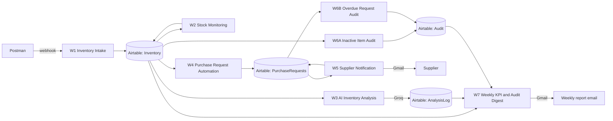

## Workflows

| No | Workflow | Trigger | Purpose |
|----|----------|---------|---------|
| W1 | Inventory Intake | Webhook | Validate sku, product_name, quantity; create the Inventory record; return HTTP 400 for invalid input |
| W2 | Stock Monitoring | Manual or scheduled run | Compare Quantity with reorder level, set Status to Low Stock or Overstock |
| W3 | AI Inventory Analysis | Manual or scheduled run | Groq (llama-3.3-70b) finds fast/slow movers, forecast notes and reorder priorities, saved to AnalysisLog |
| W4 | Purchase Request Automation | Airtable watch (Inventory, Last Updated) | Create a Pending purchase request for Low Stock items |
| W5 | Supplier Notification | Airtable watch (PurchaseRequests) | Email supplier for Pending requests, mark Sent to Supplier |
| W6A | Inventory Audit: inactive items | Scheduled | Mark inactive items, log to Audit |
| W6B | Inventory Audit: overdue requests | Scheduled | Find overdue purchase requests, log to Audit |
| W7 | Weekly KPI and Audit Digest | Weekly, Monday 08:00 | Email KPIs, latest AI analysis and audit findings |

## Public Make.com scenario links

| Workflow | Public link |
|----------|-------------|
| W1 Inventory Intake | https://us2.make.com/public/shared-scenario/GW9RXMjZ53b/workflow-1-inventory-intake |
| W2 Stock Monitoring | https://us2.make.com/public/shared-scenario/FvCr7P1p5ec/workflow2 |
| W3 AI Inventory Analysis | https://us2.make.com/public/shared-scenario/qNOFPpsIZem/workflow-3-ai-inventory-analysis |
| W4 Purchase Request Automation | https://us2.make.com/public/shared-scenario/kI5O2OSPtJQ/w4-purchase-request |
| W5 Supplier Notification | https://us2.make.com/public/shared-scenario/DVUnI3sS4ei/w5 |
| W6A Scheduled Inventory Audit | https://us2.make.com/public/shared-scenario/TNRrEA2Bh0H/w6-a-scheduled-inventory-audit |
| W6B Scheduled Inventory Audit, overdue requests | https://us2.make.com/public/shared-scenario/seg8WBdf3EX/w6-b-scheduled-inventory-audit-overdue |
| W7 Weekly Inventory KPI and Audit Digest | https://us2.make.com/public/shared-scenario/0Aa5yDoILUK/w7-weekly-inventory-kpi-audit-digest |

Detailed module-by-module notes are in [docs/workflows.md](docs/workflows.md). The Airtable design is in [docs/airtable-schema.md](docs/airtable-schema.md).

## Repository layout

```
make-blueprints/   exported Make.com scenario blueprints (JSON)
postman/           Postman collection used to simulate requests
docs/              workflow notes, Airtable schema, architecture diagram
screenshots/       testing evidence (Postman responses, Make executions)
sample-reports/    sample weekly report emails
```

## Setup

1. Create an Airtable base named warehouse with the tables in docs/airtable-schema.md.
2. In Make.com, import each file from make-blueprints/ (Scenarios, Create a new scenario, three-dot menu, Import Blueprint).
3. Reconnect the Airtable and Gmail connections in each imported scenario and re-select the base and tables.
4. Create the webhooks for W1 to W4 and copy their URLs into the Postman collection.
5. Update the recipient email addresses in the Gmail modules (W5 and W7).

## Testing

Each workflow was tested by sending a Postman request (or waiting for the schedule) and checking the Make execution log and the Airtable result. Evidence is listed in [screenshots/README.md](screenshots/README.md).

### W1 Inventory Intake

Postman request with a valid inventory record (webhook URL hidden):

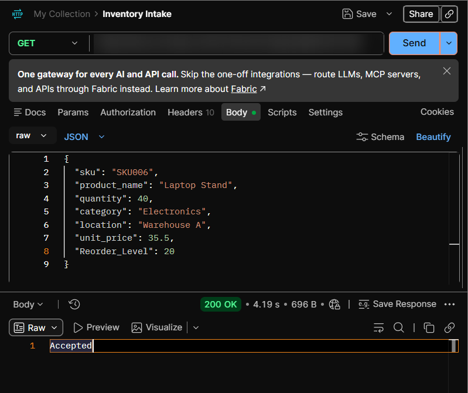

Postman request without the required fields, and the Airtable Inventory table:

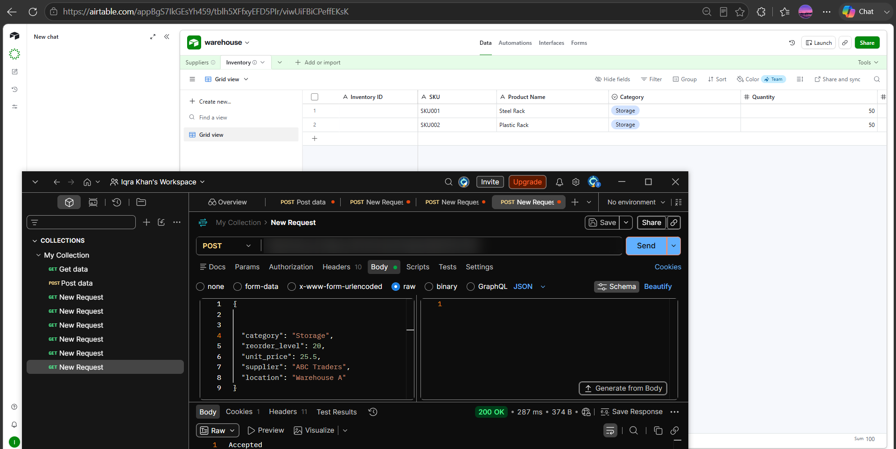

Make execution, Valid Record route (record created in Airtable):

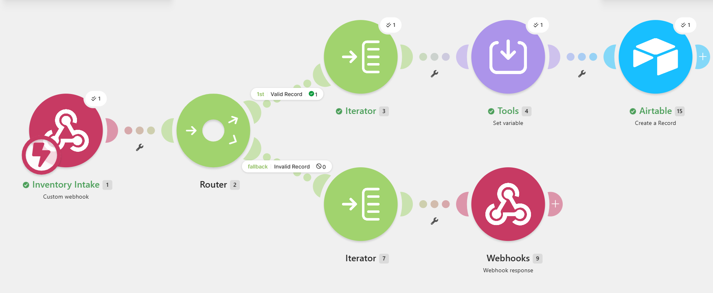

Make execution, Invalid Record route (input without sku, product_name and quantity):

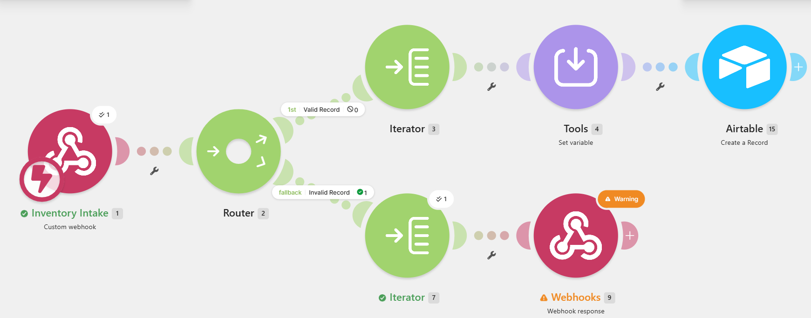

### W2 Stock Monitoring

Airtable Inventory after the run. SKU001 to SKU004 (Quantity 50, Reorder Level 100) are Low Stock, SKU005 (Quantity 180, Reorder Level 90) is Overstock:

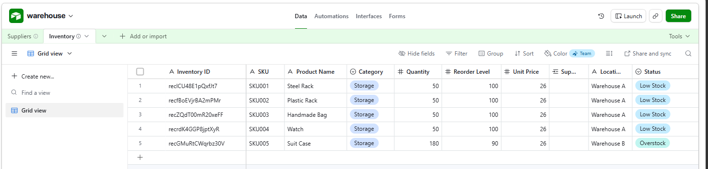

Make scenario diagram: Search Records, Router, then Low Stock and OverStock update routes:

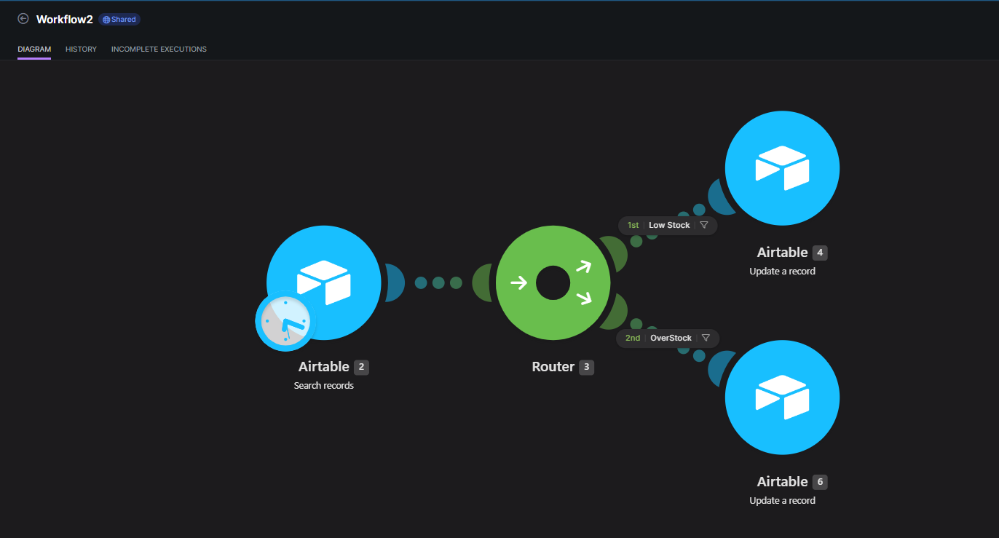

Make execution: 4 records searched, 2 went through the Low Stock route and 2 through the OverStock route:

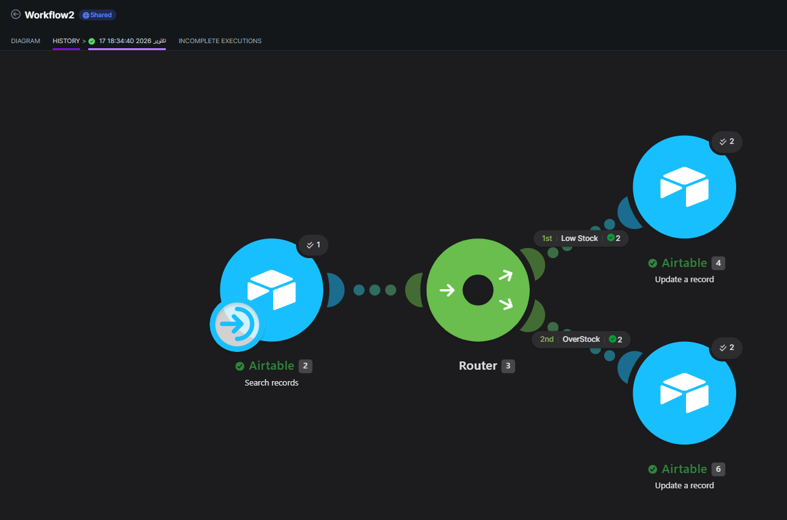

### W3 AI Inventory Analysis

Make scenario: Airtable search, Array aggregator, Groq chat completion, Parse JSON, Iterator, Text aggregator, Airtable create record:

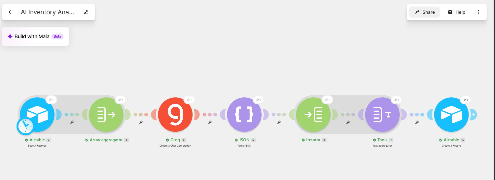

Inventory data analysed by the AI:

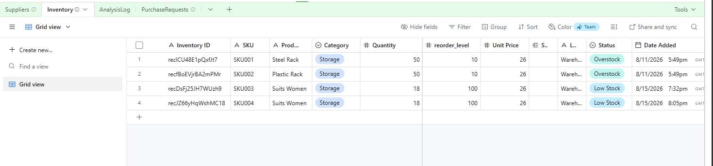

AnalysisLog records written by the workflow (forecast notes and reorder priorities):

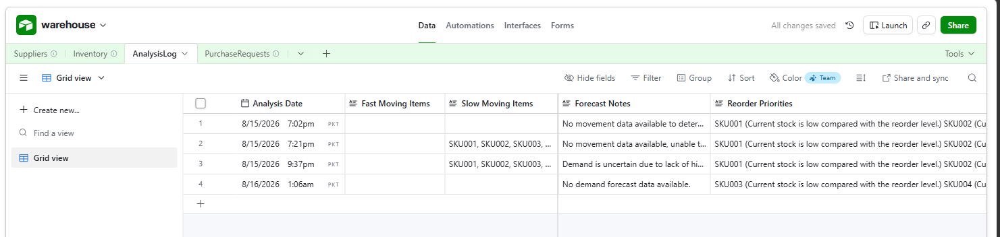

### W4 Purchase Request Automation

Make execution: Watch Records, Find Low Stock filter, Search Records, Pending filter, Create a Record:

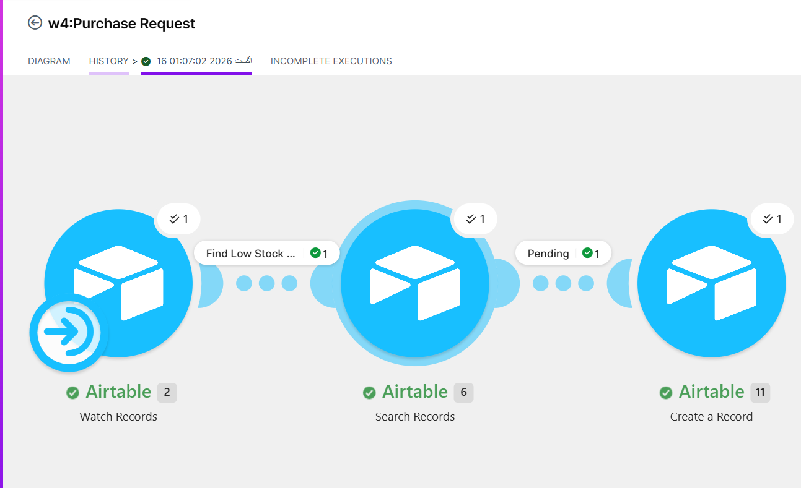

Purchase request created in Airtable (status Pending, supplier response Awaiting Response):

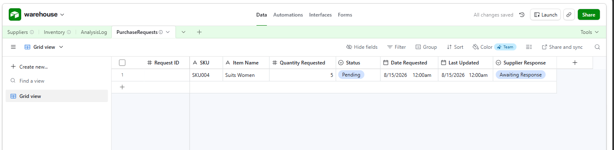

### W5 Supplier Notification

Supplier email sent through Gmail:

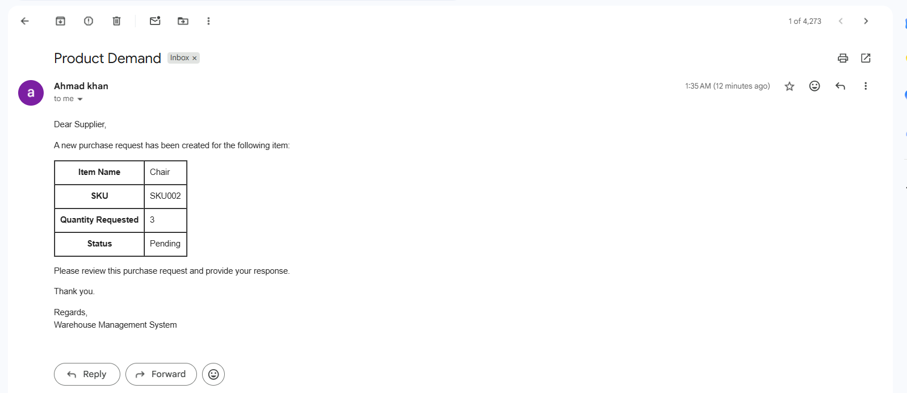

Make execution: Watch Records, Send an Email (2 emails), Update a Record (2 updates):

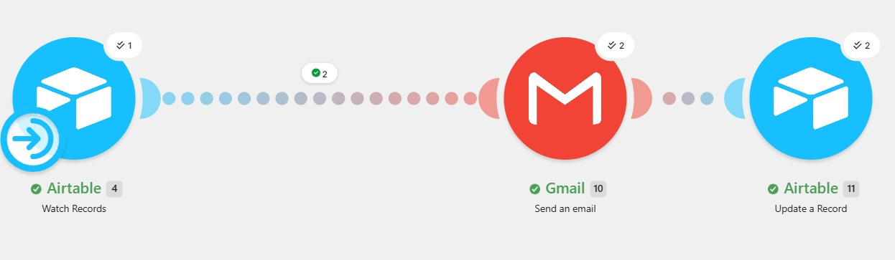

PurchaseRequests after notification (status Sent to Supplier):

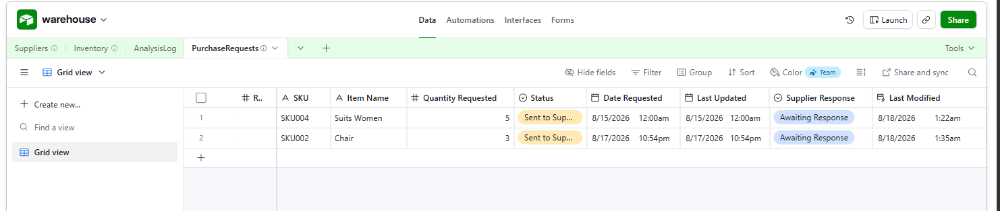

### W6A and W6B Scheduled Inventory Audit

W6A execution (inactive items):

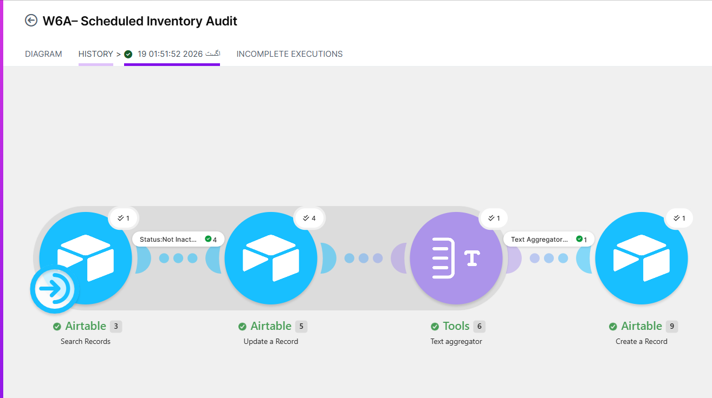

W6B execution (overdue purchase requests):

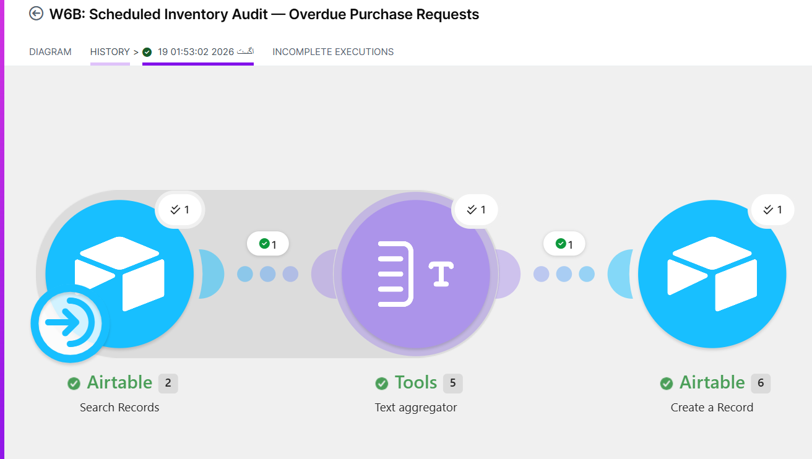

Audit table written by both workflows:

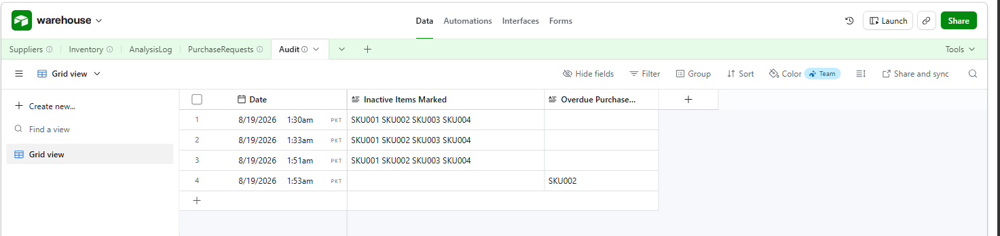

### W7 Weekly Inventory KPI and Audit Digest

Make execution:

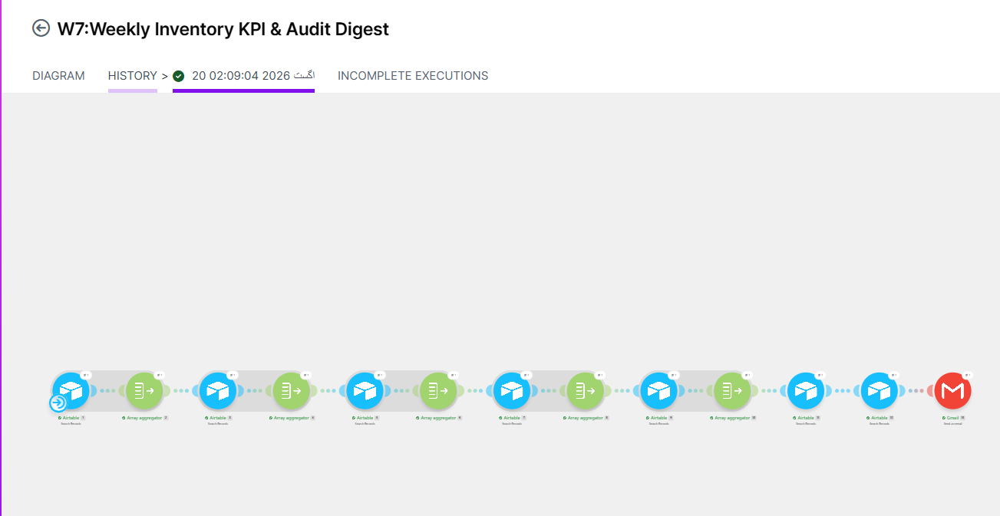

Weekly report email (also saved in sample-reports/):

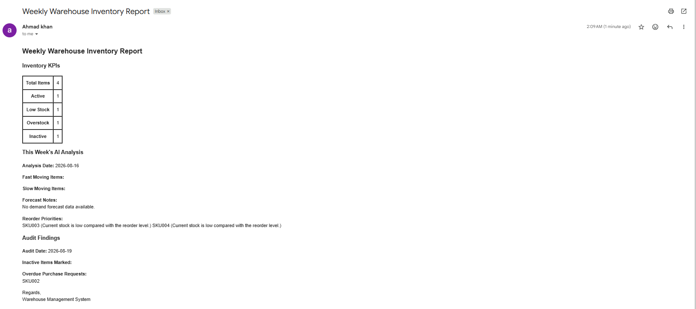

## Error handling

1. Scenarios stop after 3 consecutive errors (maxErrors = 3) so failures are not silent.
2. Filters stop a run early when there is nothing to process, for example W5 only mails records with Status = Pending.
3. See docs/workflows.md for known limitations.

## Security

No API keys or tokens are stored in this repository. Make connection IDs in the blueprints are references only; re-create the connections in your own Make account.
