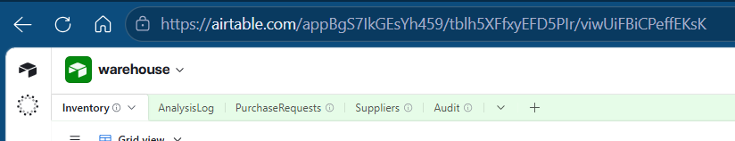

# Airtable Schema

Base: warehouse

Tables: Inventory, AnalysisLog, PurchaseRequests, Suppliers, Audit.

## Inventory

| Field | Type | Notes |
|-------|------|-------|
| Inventory ID | text / record ID | |
| SKU | text | |
| Product Name | text | |
| Category | single select | Storage, Electronics, Packaging |
| Supplier | link | to Suppliers |
| Quantity | number | |
| reorder_level | number | |
| Unit Price | number | |
| Location | text | |
| Status | single select | In Stock, Low Stock, Overstock, Normal, Inactive (W7 also counts Active, keep names consistent) |
| Date Added | date | |
| Last Updated | date | |
| Movement Type | single select | Fast-moving, Slow-moving, Stable |
| Demand Forecast | AI field | filled by AI analysis |
| Reorder Priority | single select | High, Medium, Low |
| Recommended Action | AI field | |
| Supplier Email | text | |
| AuditLog | text | |

## PurchaseRequests

| Field | Type | Notes |
|-------|------|-------|
| Request ID | number | |
| SKU | text | |
| Item Name | text | |
| Quantity Requested | number | |
| Status | single select | Pending, Approved, Rejected, Completed, Sent to Supplier |
| Date Requested | date | |
| Last Updated | date | |
| Supplier Response | single select | Awaiting Response, Accepted, Rejected |
| Last Modified | last modified time | W5 trigger field |
| Supplier Name | lookup | from Suppliers |
| Supplier Email | link | to Suppliers |

## Suppliers

Fields: name and email (linked from PurchaseRequests). Add the remaining fields here.

## AnalysisLog

| Field | Type |
|-------|------|
| Analysis Date | date |
| Fast Moving Items | long text |
| Slow Moving Items | long text |
| Forecast Notes | long text |
| Reorder Priorities | long text |

## Audit

| Field | Type |
|-------|------|
| Date | date |
| Inactive Items Marked | long text |
| Overdue Purchase Requests field | long text |
